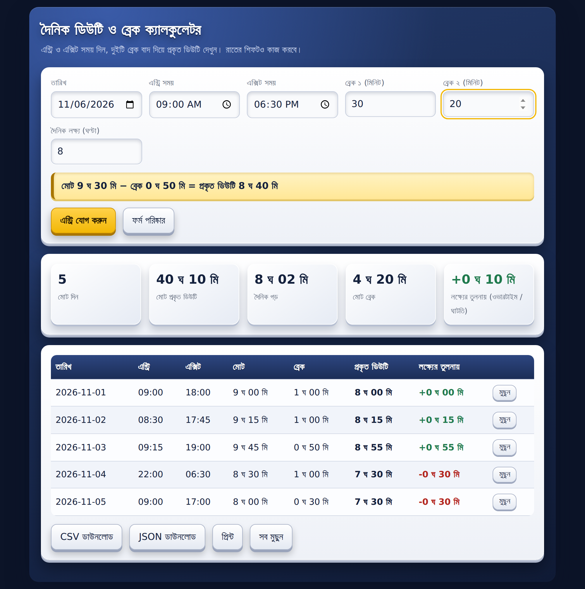
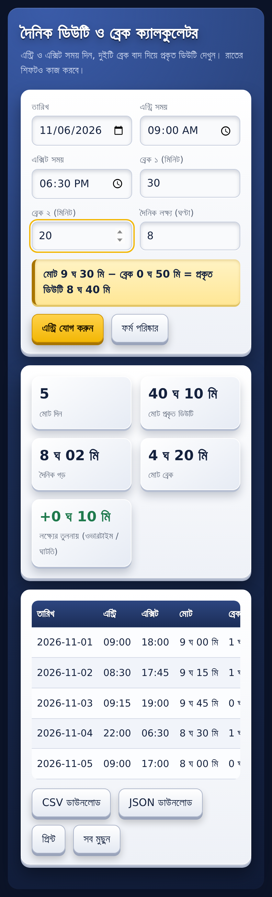

# ⏱️ Daily Duty & Break Time Calculator

A free, open-source, single-file web app that calculates your **real working hours** after subtracting breaks. Built with plain HTML, CSS and JavaScript: no frameworks, no build step, no sign-up. Works offline and runs happily inside a **Blogger** page.

> দৈনিক ডিউটি ও ব্রেক ক্যালকুলেটর: এন্ট্রি ও এক্সিট সময় দিন, দুইটি ব্রেক বাদ দিয়ে প্রকৃত ডিউটি দেখুন।

<p align="center">
  
</p>

<p align="center">
  
</p>

## ✨ Features

- **Bilingual: বাংলা / English** switch (remembers your choice, auto-picks Bangla for Bengali browsers)
- Entry time, exit time and **two separate breaks** (in minutes)
- Live calculation: `Total − Breaks = Real duty`
- **Night shifts** supported (e.g. 22:00 → 06:30)
- Adjustable daily target (default 8 h) with overtime / shortfall shown in green / red
- Summary: total days, total real duty, daily average, total breaks, overtime balance
- Data saved in your browser (`localStorage`), so it survives refresh
- Export to **CSV** (opens correctly in Excel with Bengali text) or **JSON**, and **Print**
- Responsive, 3D-styled UI, with reduced-motion and print styles

## 🚀 Quick start

1. Download or clone this repo
2. Open `index.html` in any modern browser

```bash
git clone https://github.com/iftakher-hridoy/duty-time-break-time-calculator.git
cd duty-time-break-time-calculator
# just open index.html
```

### Host it free with GitHub Pages
Repo **Settings → Pages → Deploy from a branch → `main` / root**. Your calculator will be live at `https://iftakher-hridoy.github.io/duty-time-break-time-calculator/`.

## 📰 Use it on Blogger

| Goal | File | Where to paste |
|------|------|----------------|
| Add to a page or sidebar | `blogger/page-or-widget.html` | Pages → New page → **HTML view**, or Layout → Add a Gadget → **HTML/JavaScript** |
| Calculator-only blog | `blogger/full-theme.xml` | Theme → **Edit HTML** (⚠️ replaces your whole theme, back it up first) |

> Pasting the page/widget file into *Theme → Edit HTML* gives the error
> `There should be one and only one skin in the theme`. Use `full-theme.xml` there instead.

The Blogger files wrap CSS and JS in `CDATA` so Blogger's XML parser accepts `&`, `&&` and `<`.

## 📁 Structure

```
├── index.html                 # standalone app (GitHub Pages entry)
├── blogger/
│   ├── page-or-widget.html    # fragment for Blogger pages / gadgets
│   └── full-theme.xml         # minimal full Blogger theme
├── docs/                      # screenshots
├── LICENSE
└── README.md
```

## 🛠️ Customize

All styles are scoped under `#dtc` and use CSS variables at the top of the `<style>` block, so colours are easy to change. Storage keys: `dtc_entries_v1`, `dtc_target_v1`.

## 🤝 Contributing

Issues and pull requests are welcome. Ideas: month filter, per-shift presets, dark/light toggle, multiple languages.

## 🔒 Privacy

Everything runs in your browser. No data is sent anywhere. The only external request is the optional Google Fonts stylesheet (Hind Siliguri); remove the `@import` line to go fully offline.

## 👤 Author

Made by [iFTAKHER_HRiDOY](https://iftakher-hridoy.blogspot.com/). Please keep the "Powered by" credit line when you reuse or fork this project.

## 📄 License

[MIT](LICENSE): free to use, modify and share.
